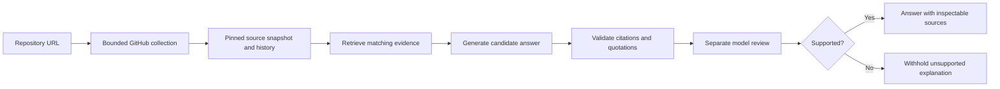
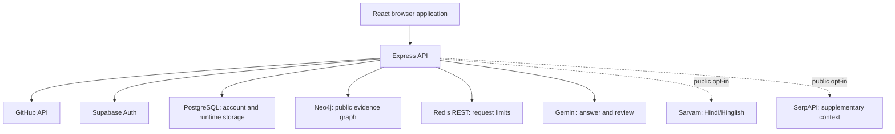

# WhyCode

**Read the code. Trace the change. Understand the decision.**

WhyCode helps developers investigate unfamiliar GitHub repositories. Ask about a file, a change or a decision, then inspect the code, commits, pull requests, issues and quotations behind the answer.

A repository can show **what changed** without recording **why someone chose it**. WhyCode connects the available records, explains what they support, and withholds an explanation when the evidence is insufficient.

> Working application with automated tests and live database verification. Production hosting and real-provider acceptance testing are separate release steps; this README does not claim a public production deployment.

## What you can do

- Explore public repositories as a guest, without an account or shared password.
- Sign in through configured email/password, Google or GitHub providers and use a dedicated account workspace.
- Connect a GitHub App to analyze selected private repositories you have permission to read.
- Ask focused questions such as “Which change introduced README?” or “What discussion explains this retry limit?”
- Inspect answers, citations, chronological timelines and repository connections.
- Zoom the repository tree, drag nodes and highlight connections from the root to a selected node.
- Save account investigations, explicitly import guest work and remove investigations or repositories from your workspace.
- Request optional Hindi/Hinglish output or supplementary web context for public investigations.

WhyCode reads repositories. It does not edit files, push commits or open pull requests.

## The user journey

| Page | Purpose |
| --- | --- |
| `/` | Product introduction and public repository exploration |
| `/account` | Sign-in, signup, password recovery and GitHub connection settings |
| `/workspace` | Signed-in repository and investigation workspace |
| `/help` | Standalone guide to the workflow and data choices |

**Guest:** connect a public repository, wait for indexing and ask a question. Work belongs to the browser's temporary guest workspace. Signing in does not silently merge it into an account: the user chooses whether to import it.

**Signed-in user:** connect a public repository in the account workspace, or connect the GitHub App and choose a permitted private repository. Signing in establishes identity; repository authorization is a separate step.

**After an answer:** follow numbered citations into the source inspector, compare records in Evidence, review dates in Timeline or explore Connections. Users can delete individual investigations, clear history or remove a repository from their workspace. Signing out does not delete saved account investigations.

## How an answer is produced



1. **Collect a bounded window:** commits, changed paths, pull requests, issues, comments and eligible text files. Source files are pinned to one revision.
2. **Connect the records:** public evidence uses Neo4j relationships. Private evidence uses isolated snapshots and explicit file/change/discussion associations.
3. **Retrieve relevant evidence:** question terms and lexical symbol hints identify candidate records. This is bounded retrieval, not a complete language parser.
4. **Generate and check:** a model drafts an explanation; the server validates cited records and quoted text, then makes a separate review call. Unsupported or unreviewed claims can cause the answer to be withheld.
5. **Present provenance:** answers retain citations, excerpts, dates and source links. Optional translation renders the finished explanation; web context is a secondary lane, not repository evidence.

Answers distinguish `current`, `historical`, `superseded` and `unresolved` evidence. A newer date alone does not prove an earlier decision was reversed. Model review can still miss semantic errors; primary sources remain the basis for judging an answer.

## Architecture and technology choices



| Technology | Responsibility and reason for using it |
| --- | --- |
| React, TypeScript, Vite | Interactive UI, typed data contracts and development/build tooling |
| Express, TypeScript | Server-owned credentials, validation, authorization and orchestration |
| GitHub REST API | Source records with their original revision, dates and URLs |
| Supabase Auth | Managed identities, verification, social login and password recovery |
| Supabase PostgreSQL | Account history plus transactional sessions, counters, workspace state and job ownership |
| Neo4j Aura / Neo4j | Public relationships between repositories, files, people, commits and discussions |
| Redis REST / Upstash | Atomic request limits across API instances |
| Gemini | Candidate explanation and a separate review pass; models are configured on the server |
| Sarvam | Optional Hindi/Hinglish output for public answers |
| SerpAPI | Optional external background information, kept separate from repository sources |
| Docker, Caddy | Packaged deployment with an HTTPS reverse proxy |

“Central” or “shared” storage means backend instances use the same database. It does **not** mean users can see each other's work. Browser identity, account ownership and repository permissions still govern access.

## Where data lives

This table describes the fully configured PostgreSQL/Redis runtime.

| Data | Location and lifetime |
| --- | --- |
| Guest repository references and answers | Encrypted PostgreSQL runtime records, keyed by an opaque browser cookie; eight-hour expiry |
| Account repository references and answers | Supabase account tables with user-scoped row-level security and explicit deletion controls |
| Login sessions | Encrypted central records; opaque HttpOnly browser cookies; provider-token expiry capped at eight hours |
| OAuth and recovery flows | Encrypted, browser-bound temporary records, consumed once atomically |
| Public source indexes | Central PostgreSQL snapshots and a public Neo4j graph, reusable across workspaces |
| Private source indexes | Separate encrypted records scoped to the current login/GitHub connection; session, permission and expiry checks |
| Request limits | Expiring Redis counters with hashed client identifiers and separate budgets |
| Daily answer usage | Atomic PostgreSQL counter per deployment and UTC day |
| Old browser history | Legacy data may remain on its original device until explicitly imported or removed |

New investigations are not saved into `localStorage`. People using the **same browser profile** can share its guest cookie; different profiles have separate guest identities.

Removing a public repository from a workspace removes that workspace's references and investigations. It does not delete GitHub data or a public index another workspace uses. Private source payloads never enter the public snapshot table or Neo4j. Saved private answers can contain excerpts; the private-question consent explains model submission and account storage.

Without central services, development fallbacks use local files and memory. Those fallbacks support one API process; do not mount one local data directory across multiple replicas.

## Decisions behind the product

| Decision | Reason and tradeoff |
| --- | --- |
| Evidence before explanation | Plausibility is insufficient without inspectable records. Retrieval, validation and review add latency. |
| Abstain when support is missing | History does not always record intent. The application should expose that gap. |
| Pin source files to a revision | Keep answers reproducible. Loading older commits does not automatically refresh current source files. |
| Separate identity from GitHub access | Social login alone must not grant private access. The GitHub App restricts access to selected repositories and read permissions. |
| Separate guest and account work | Avoid silently attaching shared-device history to an account. Import requires an explicit choice. |
| Server-owned credentials and encrypted runtime payloads | Keep provider tokens and private excerpts out of browser storage. Encryption requires a stable server secret. |
| PostgreSQL job ownership and global admission | Multiple API instances must not start duplicate work or each apply a separate concurrency allowance. |
| Atomic, versioned graph writes | A stale worker must not replace a newer graph; readers should see one committed snapshot. |
| Dedicated account and help pages | Keep major tasks and navigation understandable without relying on modal popups. |
| Cream, forest green and brown visual system | Provide a readable editorial identity. Manrope/DM Sans support the interface; Instrument Serif provides display accents. The `<?>` mark replaces the slash in a code icon with a question mark. |
| Purposeful motion | Scroll reveals, the branch trail and cursor companion illustrate exploration. Reduced-motion preferences are respected. Connections code loads on demand. |

## Indexing and recovery

- At most **two indexing leases** are active across public/private jobs in one deployment namespace.
- Jobs have unique IDs, two-minute leases, 30-second renewal and increasing generations. Stale status/snapshot writes are rejected.
- Public workers check expired jobs every five seconds, with at most three automatic restart recoveries.
- Recovery reuses an already-written snapshot when possible and checks continuation state to avoid duplicating batches.
- Private recovery starts from an authenticated workspace request and rechecks GitHub permission before resuming.
- Neo4j replaces each snapshot in one transaction with a repository lock and generation checks.
- Graceful shutdown stops recovery scheduling and gives active requests/jobs up to 30 seconds to finish.

Jobs execute in API processes, coordinated through PostgreSQL. The current implementation does not require a separate queue service or standalone worker fleet.

## Security and availability

- Private operations verify the session and GitHub repository access. GitHub App permissions are read-only.
- OAuth uses PKCE and browser-bound, single-use state. Recovery sessions are restricted to password recovery.
- Production cookies use Secure/HttpOnly settings. Supabase owns passwords; WhyCode does not maintain a password database.
- Mutations require JSON, the application request header and origin/fetch-site checks. Hosts and origins are checked on the API.
- SQL and Cypher use parameters. Source links reject unsafe schemes; untrusted text is rendered without executing it.
- The server-only `whycode_runtime` schema is inaccessible to browser anon/authenticated roles. Account tables use row-level security.
- Redis calls have one bounded retry. During outages, an explicit allowlist of reads can use per-instance limits for 60 seconds. Login, callbacks, writes and model requests remain fail-closed.
- `/healthz` is fast liveness. `/api/health` reports capabilities, caches concurrent Neo4j checks for 15 seconds and uses its own local limit.
- Answer reservations remain charged if later retrieval, validation or provider work fails. Instances use the same namespace and daily limit.

Sessions expire with provider tokens; automatic token refresh is not implemented. Deletion/expiry revoke application access but do not promise immediate physical erasure from backups. Production retention and monitoring are operator responsibilities.

## Local setup

Use Node.js **22 or 24** and npm. CI uses Node 22; Docker uses Node 24.

```sh
npm ci
```

For a **new clone**, copy the configuration template:

```powershell
Copy-Item .env.example .env
```

On macOS/Linux, use `cp .env.example .env`. Preserve an existing configured `.env`. Never commit credentials or runtime data.

### Configure services

| Capability | Variables |
| --- | --- |
| Public evidence graph | `NEO4J_URI`, `NEO4J_USERNAME`, `NEO4J_PASSWORD`; optional `NEO4J_DATABASE` |
| Answers | `LLM_PROVIDER=gemini`, `LLM_API_KEY`, `LLM_MODEL`; optional `LLM_FALLBACK_MODEL` |
| Public GitHub collection | `GITHUB_TOKEN` recommended for API limits; private access uses the GitHub App |
| Accounts | `SUPABASE_URL`, `SUPABASE_ANON_KEY`, `ACCOUNT_PROVIDERS` |
| Private repository authorization | `GITHUB_APP_CLIENT_ID`, `GITHUB_APP_CLIENT_SECRET`, `GITHUB_APP_SLUG` |
| Central runtime | `DATABASE_URL`, `DATABASE_SSL_CA_FILE`, `SESSION_ENCRYPTION_KEY` |
| Central request limits | `UPSTASH_REDIS_REST_URL`, `UPSTASH_REDIS_REST_TOKEN`, `RATE_LIMIT_NAMESPACE` |
| Optional output/context | `SARVAM_API_KEY`, `SARVAM_MODEL`, `SERPAPI_API_KEY` |
| Runtime/deployment | `PORT`, `CLIENT_ORIGIN`, `DATA_DIRECTORY`, `DAILY_ANSWER_LIMIT`, `PUBLIC_ORIGIN`, `TRUST_PROXY`, `DOMAIN` |

See [.env.example](.env.example) for defaults. `SUPABASE_ANON_KEY` is the project publishable/anon key; the account REST flow does not need a service-role key. `DATABASE_URL` is a separate server-side PostgreSQL connection string, not the Supabase project URL or a WhyCode login password. URL-encode special characters in its database password.

Download the CA certificate from your Supabase project's database SSL settings and point `DATABASE_SSL_CA_FILE` to it. The public certificate under `deploy/certs/` is not a private key; verify it is appropriate for your database. Certificate and hostname verification remain enabled.

Generate a 32-byte encryption key locally and place the output only in `.env`:

```sh
node -e "console.log(require('node:crypto').randomBytes(32).toString('base64'))"
```

Keep that key stable. Instances in one deployment must share the database, encryption key, Redis namespace and usage limits. Keep development/production namespaces separate and use a separate Neo4j database per deployment.

### Prepare a new Supabase project

Run these SQL files in the SQL Editor in this order, before starting the full runtime:

1. `supabase/migrations/20261030_account_investigations.sql`
2. `supabase/migrations/20261031_runtime_answer_budget.sql`
3. `supabase/migrations/20261031_shared_auth_flows.sql`
4. `supabase/migrations/20261031_shared_sessions.sql`
5. `supabase/migrations/20261031_guest_workspaces.sql`
6. `supabase/migrations/20261031_repository_indexes.sql`
7. `supabase/migrations/20261031_worker_coordination.sql`

The existing development project has already received these migrations. A new environment needs its own setup. Keep applied migrations intact and add a new file for future changes. See the [migration guide](supabase/migrations/README.md).

Enable chosen identity providers in Supabase. Configure the provider callbacks using the URLs supplied by Supabase. The app's local account callback is under `http://localhost:5173/api/account/callback`, including its generated flow query string. The separate GitHub App callback is `http://localhost:5173/api/account/github/callback`. Open signup/recovery links in the browser that initiated them. Use the HTTPS production origin when deploying.

### Start

```sh
npm run dev
```

Website: [localhost:5173](http://localhost:5173/). API: [localhost:4000](http://localhost:4000/healthz).

The API reads the repository-root `.env`; credentials stay on the server. In PowerShell, use `npm.cmd` if execution policy blocks `npm.ps1`.

## Verification

```sh
npm run typecheck
npm test
npm run build
# Tests and both builds together:
npm run check
npm audit --omit=dev
```

The latest QA-fix gate passed **73 API tests and 36 frontend tests**, plus both builds. These counts describe a verification run, not a guarantee of model accuracy or future production behavior.

With central services and migrations configured:

```sh
node --import tsx scripts/verify-shared-sessions.mjs
node --import tsx scripts/verify-guest-workspaces.mjs
node --import tsx scripts/verify-worker-runtime.mjs
```

These checks use real PostgreSQL/Neo4j with temporary namespaces and fabricated data; session integration uses a mocked identity provider. They cover cross-instance sessions, OAuth replay, guest isolation, concurrent changes, global worker capacity, private access revocation, recovery and stale writes. Test records are removed afterward.

`npm run verify:live` and `npm run evaluate` exercise configured integrations and can consume provider requests. Evaluation results in `docs/` are historical samples, not a representative human accuracy benchmark.

## Coverage limits

- Initial choices: **25, 75, 200 or 500 commits**; older batches can extend the window up to **5,000 commits**.
- At most **80 eligible text files**, **32 KB per file** and **500 KB total**. Unauthenticated GitHub access uses smaller budgets.
- Changed-path/detail requests and direct commit-to-PR associations cover bounded subsets of commits.
- Not every branch, file or discussion is covered. Binary, generated, credential-like and oversized paths are excluded.
- Symbol extraction is lexical. An answer cannot recover intent never recorded in the indexed evidence.
- Resource limits remain enforced; central storage does not mean unlimited repository or traffic capacity.

## Production and release status

```sh
npm run build
npm start
```

The API serves the built frontend. The included Docker Compose topology runs one app container behind Caddy. Configure the production domain, HTTPS `PUBLIC_ORIGIN`, provider secrets and databases before deployment. `TRUST_PROXY=1` is appropriate only behind the isolated trusted proxy in that topology. Do not expose Vite development ports publicly.

Central runtime behavior has been tested across API instances. Public rollout still needs real-provider acceptance, hosting/domain and OAuth configuration, production email delivery, load testing, backups with restore testing, monitoring and alerts. Passing local/database tests does not imply a completed production deployment.

## Repository map

```text
apps/web/                  React interface and frontend tests
apps/api/src/domain/       Evidence, indexing, graph and answer contracts
apps/api/src/routes/       Public/private repository and question endpoints
apps/api/src/services/     Accounts, guest workspaces, indexing and questions
apps/api/src/infrastructure/ GitHub, models, databases and encrypted storage
scripts/                   Evaluation and cross-instance verification
supabase/migrations/       Schema and access-control migrations
deploy/                    Reverse proxy and public database CA certificate
qa-audit/                  Original QA findings and fix report
docs/                      Product rationale, design notes and technical guides
```

Continue with [backend runtime](docs/backend-scaling.md), [workspace setup](docs/workspace-setup.md) and the [QA fix report](qa-audit/FIX-REPORT.md). Earlier planning documents capture design history and may describe superseded implementations; this README and the runtime guide describe the current system.
