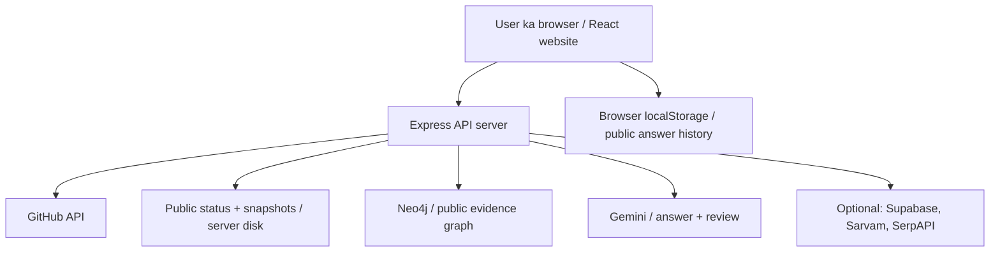
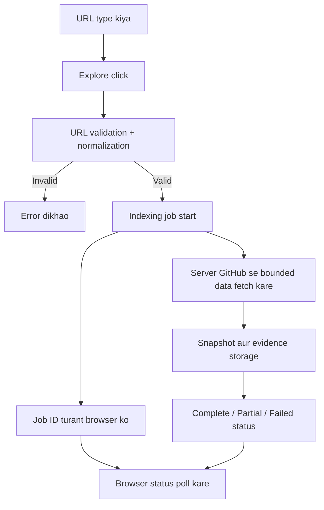
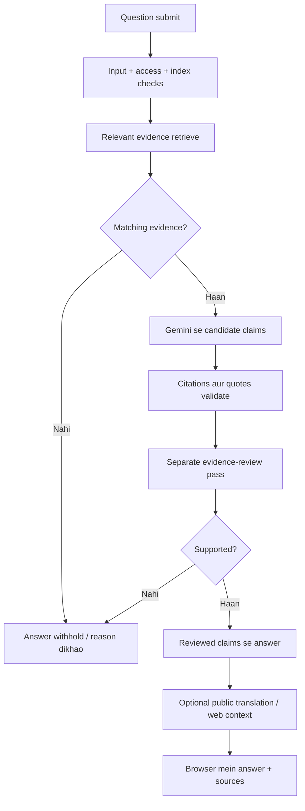
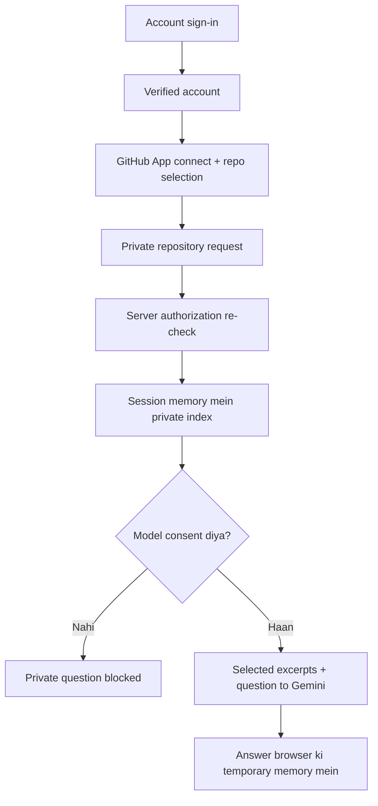

# WhyCode kaise kaam karta hai

> **Storage update (30 October 2026):** Neeche ka guide purane storage flow ko describe karta hai. Naye workspace flow mein guest history temporary server memory mein rehti hai; signed-in account history Supabase mein save hoti hai jab database migration apply ho. Purana `localStorage` data automatically delete ya import nahi hota. Current setup aur limitations ke liye [Workspace setup](workspace-setup.md) dekhein. Neeche jahan localStorage ko current save location bataya gaya hai, woh purane version ke liye hai.

**User ki poori journey, data flow aur storage — simple Hinglish mein**  
Code review ki date: 29 October 2026

Yeh document application ke current code par based hai. Yeh future product ka plan nahi hai. Optional services tabhi chalti hain jab server par unki configuration available ho. Is document ke liye secret `.env` values read nahi ki gayi hain; isliye kisi optional integration ko aapke current server par enabled assume nahi kiya gaya hai.

## 1. Sabse pehle: WhyCode karta kya hai?

WhyCode repository ki files, commits aur discussions ko connect karke code ke baare mein questions ka evidence-based answer dene ki koshish karta hai.

Example: **“README kis change mein introduce hua aur kisne likha?”**

App relevant records dhoondhta hai, model se explanation banwata hai, citations aur supporting quotes check karta hai, aur answer ke saath sources dikhata hai. Evidence sufficient nahi ho toh app answer rok bhi sakta hai. Har question ka answer milna guaranteed nahi hai.

Is flow mein app aapki repository mein commit, push ya file edit nahi karta. Yeh repository ko read karke apna limited index banata hai.

## 2. System ke main parts

| Part | Simple meaning | Iska kaam |
|---|---|---|
| React frontend | Browser mein dikhne wali website | Forms, repository list, answers, source inspector aur graph |
| Express backend | Website ke peeche chalne wala server | Requests check karna, indexing, access control aur services ko call karna |
| GitHub API | GitHub se data lene ka raasta | Repository info, commits, file content aur discussions fetch karna |
| Local server storage | Server ke disk par JSON files | Public indexing status, snapshots aur daily answer budget |
| Neo4j / Aura | Connected records ka graph database | Public repository evidence aur relationships save/query karna |
| Gemini | Answer model | Relevant evidence se claims banana aur separate review pass karna |
| Sarvam, optional | Language output service | Finished English output ko Hindi/Hinglish mein render karna |
| SerpAPI, optional | Web context service | Public questions ke liye extra background links |
| Supabase Auth, optional | Account identity provider | Email/password, OAuth aur email verification |
| GitHub App, optional | Repository permissions | Selected private repositories ka read access |

Local development mein frontend usually `localhost:5173` aur API `localhost:4000` par hoti hai. Frontend `/api/...` requests bhejta hai; Vite unhe API server tak proxy karta hai. Production mein backend built frontend files bhi serve kar sakta hai.

## 3. Jab user website open karta hai

1. Browser frontend load karta hai.
2. Frontend `/api/auth/session` se public-access readiness metadata leta hai. Yeh compatibility endpoint ab `required: false, authenticated: true` return karta hai; iska meaning personal account sign-in nahi hai. Shared password nahi maanga jaata.
3. Account flow alag se `/api/account/session` check karta hai: personal account sign-in available hai? User signed in hai? GitHub connected hai?
4. Allowed workspace ke liye repository list aur health status fetch hote hain.
5. Public workspace mein browser ki saved history validate karke restore karne ki koshish hoti hai.
6. Saved selected repository server ki current list mein available ho toh uska previous answer restore ho sakta hai.

Health check batata hai ki database, answer provider, translation aur web search available/configured hain ya nahi. Sirf website load ho jaana yeh prove nahi karta ki har backend service ready hai.

**Public aur private access ka difference:**

- **Public repository:** website kholo, URL paste karo aur Explore karo. Koi personal account ya shared workspace password required nahi hai.
- **Private repository:** personal account sign-in, GitHub App permission aur model-use consent required hain.

Account provider configured na ho toh account dialog unavailability explain karta hai. Public exploration phir bhi available rehti hai, subject to backend services aur usage limits.

## 4. URL type karne se Explore click tak

Sirf URL type karne par repository indexing start nahi hoti. URL abhi frontend ki temporary memory mein hota hai.

**Explore click karne par:**

1. Frontend `/repositories/validate` ko URL bhejta hai.
2. Backend supported GitHub URL ya `owner/repository` ko normalize karta hai. Invalid input par error aata hai.
3. Frontend `/repositories/ingest` request bhejta hai, selected history limits ke saath.
4. Server repository job create karta hai aur `202` response mein repository ID, job ID aur status deta hai.
5. Website repository workspace dikhati hai. Actual GitHub collection server par background mein chalta hai.

Public endpoint prefix `/api` hai. Private flow mein corresponding prefix `/api/private` hota hai. Private requests mein repository authorization ka extra check bhi hota hai.

Validation ka matlab poori repository download hona nahi hai. GitHub par repository milti hai ya permission available hai, yeh actual access/indexing stage mein bhi verify hota hai.

## 5. Indexing mein exactly kya fetch hota hai?

Indexing ka simple meaning hai: **repository ka selected data collect karke searchable form mein arrange karna.** Yeh full Git clone nahi hai.

Server approximately is order mein kaam karta hai:

1. Repository metadata aur default branch check.
2. Selected window ke commits.
3. Bounded commits ke changed file paths/details.
4. Pull requests aur limited direct commit-to-PR associations.
5. Issues.
6. Comments.
7. Allowed code/document files ka content, ek pinned revision par.
8. Snapshot save, phir public graph storage attempt.
9. Final counts, warnings aur status update.

UI ke initial commit choices **25, 75, 200 aur 500** hain. **Load older history** se batches append kiye ja sakte hain, maximum **5,000 commits** tak. Repository mein 50,000 commits hone ka matlab app sab 50,000 automatically fetch nahi karega.

File/discussion coverage ke alag bounds hain. Current source-reading limits mein up to 80 text files, 32 KB per file aur 500 KB combined content shamil hain. Changed paths up to 50 commits se liye jaate hain. Binary, generated, credential-like aur oversized files exclude kiye jaate hain. Yeh exclusions app ki filtering hain; inhe perfect secret-detection guarantee na samjhein.

Older history append karte waqt existing source snapshot ka pinned revision reuse ho sakta hai. Isliye “aur purane commits load kiye” ka meaning “latest source files dobara read ho gayi” nahi hai. Refresh index fresh window start karta hai.

### Progress bar kaise update hota hai?

Browser server se baar-baar status poochhta hai. Isse **polling** kehte hain. Normal successful polling delay lagbhag 1.5 seconds hai; network failure par retry delay badhta hai, maximum 10 seconds tak. Yeh WebSocket live stream nahi hai.

- **Complete:** indexing flow complete hua.
- **Partial:** collected snapshot available ho sakta hai, lekin graph storage jaise kisi part mein issue hua; warnings inspect karni chahiye.
- **Failed:** indexing fail hui; retry ki zaroorat ho sakti hai.

Partial status par question form available ho sakta hai, lekin answer tab bhi actual evidence/database availability par depend karta hai.

## 6. Question type karne aur Find the answer click karne par

Question type karne se model call nahi hoti. **Find the answer** ya supported Ctrl/Command + Enter action par request jaati hai.

Request mein repository ID, question, language aur optional web-context choice jaati hai. Private question mein explicit model-consent flag bhi chahiye.

Server pehle input aur index readiness check karta hai. Current question limit 500 characters hai. Uske baad:

1. Question ke tokens se matching entities resolve hoti hain.
2. Relevant evidence records collect hote hain.
3. Public flow Neo4j graph reader use karta hai; private flow session snapshot reader use karta hai.
4. Matching evidence na ho toh app explanation withhold karke limitation batata hai.
5. Evidence mile toh question aur selected evidence Gemini ko bheje jaate hain.
6. Model candidate claims, citations aur supporting quotes deta hai.
7. Code citations aur quote support validate karta hai.
8. Separate model pass claims ka evidence review karta hai.
9. Approved claims se final answer assemble hota hai; invalid/unreviewed explanation withhold ho sakti hai.
10. Optional translation/web context process hota hai, phir result browser ko milta hai.

Second review pass ka meaning necessarily doosra independent model/vendor nahi hai. Yeh configured answer provider ka separate review call hai. Checks ke baad bhi human source verification useful hai.

**Translation:** Hindi/Hinglish select karne par reasoning English mein hoti hai; finished answer ya abstention text Sarvam ko translation ke liye ja sakta hai. Service unavailable ho toh English fallback aur warning aa sakti hai.

**Web context:** opt-in hone par repository name aur question ka bounded search query SerpAPI ko jaata hai. Yeh links repository evidence se separate background reading hain. Private flow mein web search aur translation disabled hain.

## 7. Result screen par har action ka effect

| User action | Kya hota hai? | Nayi network request? |
|---|---|---|
| Answer tab | Current answer, cited sources aur checks dikhte hain | Normally nahi |
| Citation ya cited-source card | Source inspector khulta hai, selected record focus hota hai | Normally nahi; excerpt answer response mein already aaya tha |
| Evidence tab | Retrieved records aur cited badges dikhte hain | Normally nahi |
| Source number click | Inspector mein doosra existing record select hota hai | Normally nahi |
| Timeline tab | Response se dated records dikhte hain | Normally nahi |
| Connections tab | Repository graph overview load hota hai | Haan, graph pehli baar unavailable ho toh |
| Graph node click | Repository se node tak route highlight hota hai | Current interaction mein local state change |
| Node drag / zoom / pan | Graph ka local arrangement/view change hota hai | Nahi; GitHub/Neo4j data edit nahi hota |
| Fit all / Reset layout | Graph view/layout adjust hota hai | Nahi |
| Open original source | GitHub/source link khulta hai | Browser external site visit karta hai |
| Copy answer | Answer clipboard mein copy hota hai | Normally nahi |
| Recent investigation click | Saved in-memory/browser-history result restore hota hai | Model dobara call nahi hota; graph baad mein fetch ho sakta hai |
| Refresh index | Repository ka fresh indexing run start hota hai | Haan |
| Load older history | Older commit batch append hoti hai | Haan |

Graph complete repository ki unlimited visual copy nahi hai. Current overview recent commits aur linked sources ka bounded view hai. Public reader mein recent-commit overview limit 8 hai. Tree ek route per source dikhata hai; extra recorded relationships text section mein mil sakte hain.

Graph ke dragged node positions aur zoom browser history mein persist nahi kiye ja rahe. Component remount/reload par view reset ho sakta hai.

## 8. Data abhi kahan save ho raha hai?

| Jagah | Kya save hota hai? | Reload / close ka effect |
|---|---|---|
| React memory | Typed text, selected tabs, open overlays, current graph layout, current UI state | Page reload/close par reset; saved public state ka kuch part restore ho sakta hai |
| Browser `localStorage` | Public selected repository ID aur latest up to 20 answer-history records, including evidence/excerpts | Normally same browser profile/origin mein reload aur restart ke baad rehta hai; browser clear kare toh chala jaata hai |
| Browser cookies | Opaque session identifiers; password ya raw provider token nahi | Expiry, logout aur browser cookie settings ke hisaab se |
| Server disk | Public status JSON, normalized repository snapshot JSON, daily budget counter | Normal browser close aur server restart ke baad bhi reh sakte hain |
| Server memory | Cached public statuses, indexing jobs, rate limits, sessions, account tokens, private indexes | Process restart par memory state chali jaati hai |
| Neo4j / Aura | Public repository evidence nodes aur connections | Browser close se delete nahi hota; database ki apni persistence apply hoti hai |
| Supabase, configured ho toh | Account identity/password-authentication records aur verification handling | WhyCode server restart se account delete nahi hota |
| External AI/search providers | Selected request data processing ke liye bheja jaata hai | Unki retention policies is repository se establish nahi hoti |

### Browser history ka exact scope

Storage key `whycode.workspace.v2` hai. Ismein public history ka actual answer object aur evidence bhi ho sakta hai—sirf question titles nahi. Isliye **“history clear” important hai agar shared computer use ho raha ho.**

Save tab hota hai jab public workspace ki startup readiness check aur hydration complete ho. Yahan readiness marker personal account login nahi hai. Private-mode save/restore helpers storage access se pehle return karte hain. Restore par nested records validate hote hain; malformed entries discard hoti hain. History 20 records tak bounded hai; serialized data ke liye approximately 2 million JavaScript characters ki limit hai, exact 2 MB byte guarantee nahi.

**Local history cloud-synced nahi hai.** Doosre browser, browser profile ya device par wahi questions automatically nahi milenge. Different website origin ka localStorage bhi separate hota hai.

### Public server storage

Normal configuration mein default data folder repository root ka `.whycode` hai; `DATA_DIRECTORY` se location change ho sakti hai. Repository IDs ke hashes se filenames bante hain. Hash filename ka meaning content encryption nahi hai: JSON snapshots encrypted-at-rest hone ki guarantee code nahi deta.

Status index startup par disk se memory mein load hota hai. Polling/status reads memory copies se hoti hain. Status write pehle disk file atomically replace karta hai, phir memory update karta hai. Source snapshots aur budget counter abhi bhi local-file operations use karte hain.

Public repositories workspace-level list hain, personal account ke separate cloud workspace nahi. Backend mein question-answer history save karne ka separate database flow abhi nahi hai; public answer-history persistence browser ki responsibility hai.

## 9. Private repository ka flow alag kaise hai?

1. Account provider configured hona chahiye.
2. User supported email/password, Google ya GitHub sign-in method use karta hai.
3. Verified account identity milti hai.
4. GitHub App authorization se repository access connect hota hai. **GitHub se sign-in aur selected repository permission same step nahi hain.**
5. User GitHub par App ke liye repositories select karta hai.
6. Private mode mein server account/GitHub session verify karta hai aur repository access dobara check karta hai.
7. Private snapshot session-specific server memory mein index hota hai. Yeh private route public file store/Neo4j graph write use nahi karta.
8. Answer ke liye explicit model consent required hai. Consent dene par question aur retrieved private excerpts configured answer model ko jaate hain.

Private questions browser `localStorage` history mein save nahi hote. Private UI history page memory mein dikh sakti hai, lekin reload par us answer history ka browser restore nahi hota.

Private contexts expired/disconnected sessions ke liye subsequent request handling par prune hote hain. “Session data expire ho gaya” ka meaning immediately guaranteed secure memory erasure nahi hai. Pending background operations apna kaam finish kar sakte hain; server restart memory ko hata deta hai.

## 10. Account aur session data kaise handle hota hai?

Email/password account authentication Supabase Auth ke through hoti hai. Website/backend password ko sign-in request mein process/forward karte hain; WhyCode ki local snapshot files password database nahi hain.

Browser ko opaque, HTTP-only session cookie milti hai. Account access token aur connected GitHub token server memory mein rehte hain, frontend localStorage mein nahi. Production cookies secure flag use karti hain. Public exploration ke liye shared-password cookie issue nahi hoti. Personal account cookie private access ke liye use hoti hai.

Shared workspace-password session ab nahi hai. Account session provider expiry se bounded hoti hai, maximum 8 hours. Current implementation mein automatic token-refresh/persistent-login store ka full flow nahi hai; expiry ya server restart ke baad sign-in dobara karna pad sakta hai.

### Create account, Google/GitHub sign-in aur forgot password

- **Create account:** configured email provider ke saath user email, new password aur confirmation enter karta hai. New password minimum 12 characters hai. Backend signup Supabase ko forward karta hai aur email-verification message dikhata hai. Unconfirmed signup response se local account session create nahi hoti. Verification callback successful ho toh verified session issue ho sakti hai; user ko sign-in guidance bhi milti hai.
- **Email sign-in:** backend credentials identity provider ko bhejta hai, verified user confirm karta hai, phir WhyCode session cookie issue karta hai. Account email/user ID aur provider token server session mein associate hote hain.
- **Google/GitHub sign-in:** browser provider authorization flow par redirect hota hai. Callback mein state aur PKCE flow verify hote hain; successful token exchange ke baad verified local account session banti hai. Callback fail ho toh account dialog retry notice dikha sakta hai.
- **Forgot password:** email submit karne par reset link request hoti hai. UI generic message dikhati hai, taaki account exist karta hai ya nahi unnecessarily reveal na ho.
- **Reset password:** link request wale browser mein kholo, phir new password choose karo. Short-lived recovery session sirf password update ke liye hai. Related local sessions invalidate hote hain; phir new password se sign in karo.
- **GitHub Connect / Reconnect:** signed-in account ke saath alag GitHub authorization flow chalta hai; connected profile aur token session mein attach hote hain. Repository selection GitHub App installation settings par depend karti hai.

Yeh application ke implemented flows hain. Provider configuration, allowed redirect URLs, enabled social providers aur email setup complete na ho toh buttons/features available nahi honge ya flow fail ho sakta hai.

Account logout account/GitHub session access invalidate karta hai. GitHub disconnect GitHub access hataata hai. Public workspace ka separate shared-password sign-out action ab nahi hai. Account sign-out account deletion nahi hai aur public local history automatically clear nahi karta.

## 11. Website chhodne par kya hota hai?

| Situation | Browser/UI | Server aur stored data |
|---|---|---|
| Doosri tab/app par jaana | Page normally loaded rehti hai; companion animation hidden page par pause hoti hai | Sessions/data automatically delete nahi hote |
| Home par wapas jaana | Current investigation selection reset hoti hai | Saved public history aur indexes delete nahi hote |
| Page reload | React state reset, startup requests dobara | Public history restore ho sakti hai; same valid account session ka private index server memory mein abhi available ho sakta hai |
| Website tab close | Page memory, follower, graph layout aur browser polling khatam | Public files/Neo4j/history automatically delete nahi hote; valid server session/private context turant destroy nahi hota |
| Public website chhodna | Shared-password sign-out ki zaroorat nahi; public access open hai | Public local history aur indexes rehte hain; history separately clear kar sakte hain |
| Account sign-out / GitHub disconnect | Account/private access state change; private UI clear hoti hai | Session authorization invalidate; private context cleanup request-driven ho sakti hai |
| Clear browser history button | In-app answer history clear hoti hai aur public storage update hoti hai | Repository indexes unchanged; cookies aur account record delete nahi hote |
| Server restart | Browser ko reconnect/sign-in ki zaroorat ho sakti hai | Public disk data survives; memory sessions/private indexes/rate limits reset; interrupted saved jobs failed mark hote hain |

**Tab close karna logout nahi hai.** Cookie valid rahe toh site dobara kholne par session recognize ho sakta hai.

Browser close/navigation se already-started indexing ya model work ko guaranteed cancel karne ka server-side flow abhi nahi hai. Frontend stale responses ignore kar sakta hai; isse backend provider work automatically cancel nahi hota. Request timeout bhi guaranteed provider-side cancellation ka proof nahi hai.

## 12. Data kahan-kahan bahar ja sakta hai?

| Service | Kis action par | Kya data ja sakta hai |
|---|---|---|
| GitHub | Indexing, private authorization checks | Repo identity, file/commit/discussion requests; server-side authorization token |
| Neo4j/Aura | Public indexing aur querying | Normalized public records, excerpts aur relationships |
| Gemini | Evidence-based answer + review | User question aur retrieved source evidence; private evidence ke liye explicit consent |
| Sarvam | Public Hindi/Hinglish output opt-in | Finished answer/withheld-answer text |
| SerpAPI | Public web-context opt-in | Repository name + bounded question query |
| Supabase / OAuth provider | Account sign-in, verification, recovery | Identity/authentication data required by the chosen flow |

App poori repository har question ke saath model ko bhejne ke liye designed nahi hai; selected retrieved evidence bhejta hai. Lekin selected excerpts sensitive ho sakte hain, especially private repositories mein.

API logs code ke hisaab se request ID, method, route, status aur duration log karte hain; questions, bodies, cookies aur query strings intentionally log nahi kiye jaate. Hosting proxy, infrastructure aur provider logs ka behavior is code review se prove nahi hota.

API mutating requests ke liye JSON format aur application request header check karta hai. Host/origin checks, request-size limits, rate limits aur production HTTPS/cookie rules bhi hain. Yeh controls hain, complete security certification nahi. Frontend ko provider API keys bhejne ki zaroorat nahi; configured integration calls backend se hoti hain.

## 13. Failure aur limits user ko kaise affect karte hain?

- Invalid URL: validation error; valid indexing job start nahi hoti.
- GitHub permission/rate-limit problem: indexing failure/warning ya private-access error aa sakta hai.
- Neo4j unavailable: public answering fail ho sakti hai, even when disk snapshot available ho.
- Gemini unavailable: answer error; app fake successful explanation show nahi karna chahiye.
- Review fail: explanation withhold ho sakti hai.
- Translation/search unavailable: English/repository answer ke saath warning mil sakti hai.
- Browser storage blocked/full: current page investigation chal sakti hai, lekin history persistence unavailable ho sakti hai.
- Too many requests: rate-limit error aur retry guidance.

Current indexing concurrency process-wide maximum 2 hai. Question investigations bhi process-wide maximum 2 hain. Workspace repository cap 30 hai. Yeh abhi durable distributed queue nahi hai; capacity full ho toh request reject/retry hoti hai.

Default daily answer budget 100 hai; configuration se change ho sakta hai. Durable file store active ho toh budget disk par survive karta hai. Reservation model execution se pehle hoti hai, isliye failed/invalid attempt bhi applicable route mein budget consume kar sakta hai; yeh successful-answer billing counter nahi hai.

## 14. Current system ki practical boundaries

1. Browser history device-local hai; account-based cross-device question sync nahi hai.
2. Public repository indexes shared workspace mein hain; per-user public isolation ka full product flow nahi hai.
3. Private indexes session-memory based hain; permanent private repository archive nahi hai.
4. Index bounded hai: har branch, file, discussion aur commit cover nahi hota.
5. Current code retrieval entity/token aur lexical matching use karta hai; ise automatic full semantic code understanding na samjhein.
6. Local files, sessions aur rate limits abhi single-process architecture hain. Multiple replicas ke liye shared persistence/session counters aur durable workers chahiye.
7. Browser-history clear ya account sign-out full server-data deletion nahi hai. Current UI mein complete repository snapshot/Neo4j deletion workflow nahi hai.
8. Reviewed answer source-supported hone ki koshish hai; historical intent ya correctness ki absolute guarantee nahi.

## 15. Ek complete example

Anil website kholta hai. App session aur health check karta hai, public repository list laata hai aur valid local history restore karta hai.

Anil `octocat/Hello-World` enter karke Explore click karta hai. Backend URL normalize karta hai, bounded indexing start karta hai aur job ID deta hai. Browser polling se progress dikhata hai. Public snapshot disk par aur configured graph Neo4j mein save hota hai.

Anil poochhta hai: “README kis commit mein introduce hua?” Server index se evidence retrieve karta hai, Gemini candidate aur review calls karta hai, phir approved claims aur citations return karta hai. Browser answer dikhata hai aur public answer object localStorage history mein save kar sakta hai.

Anil citation click karta hai. Already received excerpt inspector mein khulta hai; model dobara call nahi hota. Connections open karne par graph request hoti hai. Node select/drag/zoom local view change karta hai, repository ko nahi.

Anil tab close karta hai. Browser polling aur temporary page state khatam hoti hai. Public local history, server snapshot aur Neo4j graph automatically delete nahi hote. Dobara website kholne par eligible saved history restore ho sakti hai.

Private repo ke same example mein personal account + GitHub permission + model consent required honge. Index server-session memory mein rahega, aur answer history localStorage mein save nahi hogi.

## 16. Technical reference: code mein kahan dekhein?

Paths repository root ke relative hain.

| Topic | Main files |
|---|---|
| User actions aur overall page | `apps/web/src/App.tsx` |
| API requests/timeouts | `apps/web/src/lib/api.ts` |
| Account lifecycle | `apps/web/src/hooks/useAccount.ts`, `apps/api/src/services/account-service.ts` |
| Workspace load aur account access | `apps/web/src/hooks/useWorkspaceLoading.ts`; personal account flows `useAccount.ts` aur `AccountDialog.tsx` mein |
| Browser history | `apps/web/src/lib/workspace-history.ts`, `hooks/useWorkspacePersistence.ts` |
| Polling | `apps/web/src/lib/repository-polling.ts` |
| Backend wiring/configuration | `apps/api/src/app.ts`, `server.ts`, `config.ts` |
| Indexing | `apps/api/src/services/indexing-service.ts` |
| Durable public store | `apps/api/src/infrastructure/indexing/file-indexing-store.ts` |
| Public graph reads/writes | `apps/api/src/infrastructure/graph/neo4j-graph-reader.ts`, `neo4j-graph-store.ts` |
| Private access/storage | `apps/api/src/routes/private-routes.ts` |
| Answer generation/checks | `apps/api/src/services/question-service.ts` |
| Security/session gate | `apps/api/src/middleware/security.ts` |

**Yaad rakhne wali baat:** website par visible data, browser mein saved data, server disk ka index, Neo4j records aur external-provider processing—yeh sab alag layers hain. Ek layer clear/close karne se baaki layers automatically clear nahi hoti.
