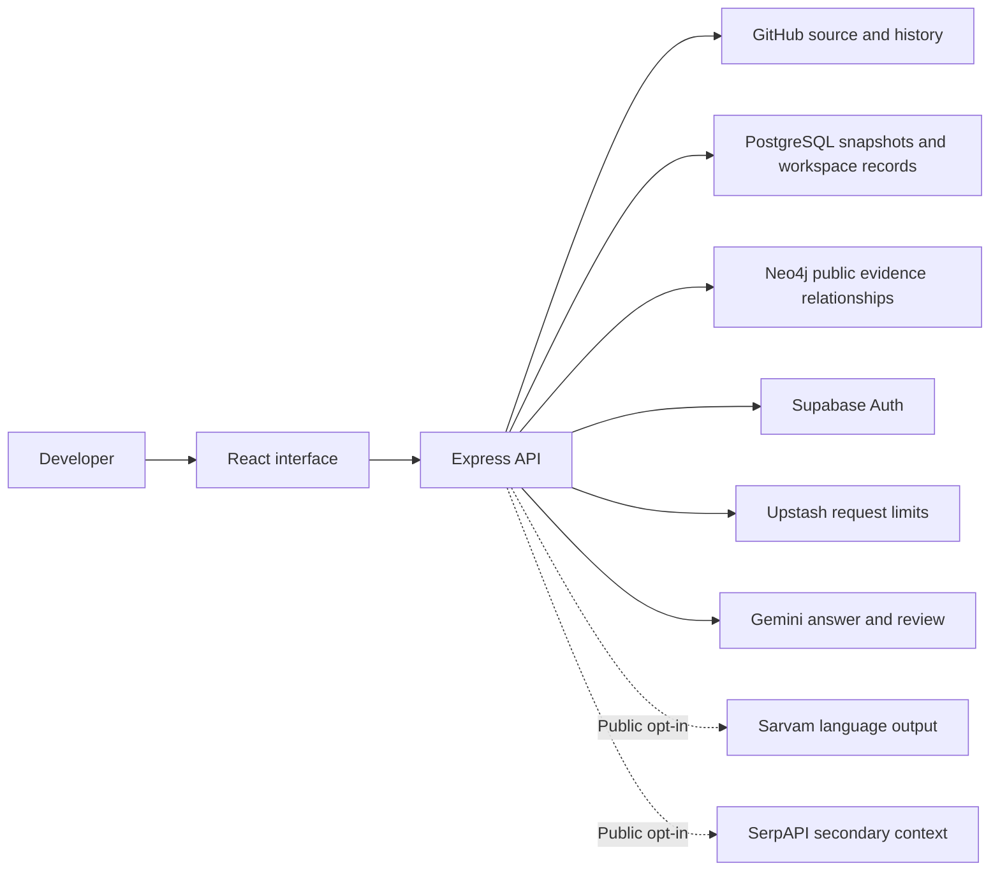

# WhyCode — submission copy

Use the sections matching the portal's actual questions. Adapt length to the displayed limits.

## Project title

WhyCode — Evidence-backed repository understanding

## Tagline

Read the code. Trace the change. Understand the decision.

## One-sentence description

WhyCode helps developers investigate GitHub repositories by connecting source files, commits and discussions into explanations with inspectable evidence, while withholding conclusions the indexed records cannot support.

## Short description

Understanding a codebase means understanding its history. WhyCode connects GitHub source files, commits, pull requests and issues so developers can ask focused questions and inspect the records behind an explanation. Public repositories work without login; account workspaces support saved investigations and authorized private repositories. Citations, timelines and an interactive connection tree make answers easier to verify. When the indexed evidence does not establish a rationale, WhyCode withholds the explanation instead of presenting a guess as a fact.

## Problem and target users

Developers joining a project often need to understand why a file changed, which discussion led to a decision, or whether an older explanation still applies. That context is scattered across code, commits, pull requests and issues. Reading only current code can miss the history; reading a generated summary without checking its sources can introduce an unsupported explanation.

WhyCode is designed for developers onboarding to unfamiliar repositories, open-source contributors tracing changes, and maintainers revisiting earlier decisions. The goal is to reduce the manual effort of assembling relevant records while keeping the evidence visible. Time savings have not yet been measured in a user study.

## Solution and user flow

A user connects a public GitHub repository and chooses a bounded history window. WhyCode collects eligible source files at a pinned revision alongside available change and discussion records. The user asks a focused question about a file, change or decision. The system retrieves evidence, generates a candidate answer, checks citations and quotations, and runs a separate model review. The result includes inspectable sources or an explanation of why support is insufficient.

Users can open evidence excerpts and original GitHub links, compare a chronological timeline, and explore a zoomable, draggable repository connection tree. Selecting a node highlights its path from the root. Signed-in users get a dedicated workspace with saved investigations, explicit guest-work import and deletion controls. Private repository access requires a separate read-only GitHub App authorization.

## What is distinctive

- **Traceable explanations:** citations connect claims to retrieved repository records, with excerpts and original links.
- **Historical context:** timelines and evidence status help distinguish older records from current code without assuming the latest date overrides earlier intent.
- **Explicit uncertainty:** unsupported or unreviewed explanations can be withheld. This is a mitigation, not a guarantee against semantic mistakes.
- **Connected exploration:** users can inspect relationships and follow a selected node back to the repository root.
- **Deliberate data boundaries:** guest work, account history and private source indexes have separate ownership and access rules.
- **Optional language accessibility:** public answers can be rendered in Hindi/Hinglish through Sarvam; external web context is optional and separate from repository evidence.

These describe the implementation's design choices, not a claim that no other product offers similar capabilities.

## Architecture and implementation

The React/TypeScript frontend communicates with an Express/TypeScript API. GitHub REST APIs provide bounded source and history records. Public repository relationships are stored in Neo4j Aura, while PostgreSQL stores snapshots, account investigations, encrypted runtime records and indexing coordination. Supabase Auth manages identity; the GitHub App separately grants selected-repository read access. Upstash Redis provides atomic request limits. Gemini generates and reviews explanations; Sarvam and SerpAPI support optional public language output and secondary web context.

Indexing uses database-backed job ownership, leases and increasing generations to reject stale writes. Public graph replacement occurs in one Neo4j transaction. Private source snapshots are encrypted separately and do not enter the public evidence graph. The Docker deployment serves the frontend and API together on Render.

## Use of Neo4j

WhyCode uses Neo4j for relationships among public repository entities and evidence records, enabling related context to be retrieved and inspected together. Relationship paths help explain how a source relates to the question. Versioned transactional writes prevent a stale indexing worker from replacing a newer public graph. Private source analysis follows a separate isolated-snapshot path; it is not written into the public Neo4j graph.

## Use of Sarvam

Sarvam provides optional Hindi/Hinglish rendering of public explanations. Repository evidence is collected and checked before language rendering. This helps users engage with technical context in a more comfortable language while retaining citations. Translation remains model-generated and should be checked against the original sources. The feature is not enabled for private investigations.

## Security and privacy decisions

Identity and repository permission are separate. Provider secrets remain server-side, sessions use opaque HttpOnly cookies, runtime/private payloads are encrypted, and account tables use user-scoped row-level security. Private repository operations check session and GitHub access. Guest work belongs to a temporary browser workspace and is imported into an account only by explicit action. New investigations are not saved in localStorage. Application deletion controls remove the relevant saved work; they do not erase GitHub content or promise immediate deletion from backups.

Private questions and retrieved excerpts can be sent to the configured model provider after explicit consent. WhyCode is not an offline or zero-data-transfer system, and no independent security certification is claimed.

## Validation and current status

WhyCode is deployed at https://whycode-76qv.onrender.com. The latest documented verification run passed 73 API tests and 36 frontend tests, plus both builds. Separate integration checks exercised real PostgreSQL and Neo4j using fabricated records and temporary namespaces, including session continuity, guest isolation, concurrent updates, job recovery and stale-write rejection. Some identity tests use a mock provider.

These checks establish selected software behaviors; they are not a measured answer-accuracy benchmark, independent penetration test or production load test. Hosted end-to-end acceptance should be checked before the final demonstration.

## Challenges and decisions

1. **Missing historical intent:** a commit can show a change without explaining its reason. We keep provenance visible and permit abstention.
2. **Private access versus convenience:** signing in does not grant repository access. A separate GitHub App authorization limits access to selected repositories.
3. **State across restarts:** encrypted database-backed sessions and workspaces avoid depending on one browser's localStorage or a container's local disk.
4. **Overlapping workers:** leases, global indexing admission and version checks coordinate work and block stale updates.
5. **Readable evidence:** dedicated workspace/help pages, source inspection and a navigable connection tree organize the investigation rather than presenting one large answer block.

## Limitations

Indexing is bounded: it does not cover every branch, file or discussion. Current settings support initial history choices up to 500 commits and incremental extension up to 5,000 commits, plus eligible text-file limits. Symbol hints are lexical rather than full program analysis. Model review and quotation checks do not establish that every inference is correct. Sessions expire without automatic token refresh. Render Free can sleep after inactivity. Custom SMTP is deferred, so public email verification/recovery delivery is restricted; judges should use guest access or configured social login.

## Future work

Add production email delivery, broader hosted acceptance and load testing, monitoring and backup restore checks. Evaluate evidence quality with a labeled question set and measure developer task completion against a manual baseline. Improve retrieval and language-aware symbol analysis before expanding repository coverage. These are planned improvements, not completed capabilities.

## AI and third-party disclosure

Draft for the team to review: We used OpenAI Codex as an AI coding assistant during implementation, UI iteration, debugging, testing assistance and documentation preparation. Team members are responsible for reviewing the submitted work and explaining its behavior. Runtime AI services include Gemini for candidate answers and separate model review, and Sarvam for optional public Hindi/Hinglish output. SerpAPI supplies optional external context. The project also uses GitHub APIs, Neo4j Aura, Supabase, Upstash Redis, Render and open-source packages including React, Vite, TypeScript and Express. Exact package dependencies are recorded in the repository manifests and lockfile. Add any other tools or assets used by team members before submission.

## Judge access note

Live demo: https://whycode-76qv.onrender.com

Code: https://github.com/Anilcodee/whycode

Start with guest public-repository analysis; no account is required for that flow. A small repository such as `octocat/Hello-World` is a useful first example. Ask: “Which commit introduced README, and who authored it?” Inspect the returned records rather than expecting a prewritten answer. The small example illustrates provenance, not rich architectural rationale.

For a richer history demonstration, use a public repository with a known documented decision and rehearse the exact question against the indexed window. Social login is available when provider configuration permits the judge's account. Private repository analysis requires the judge to authorize their own selected repositories; never distribute personal credentials. The free hosting service may need time to wake up.
